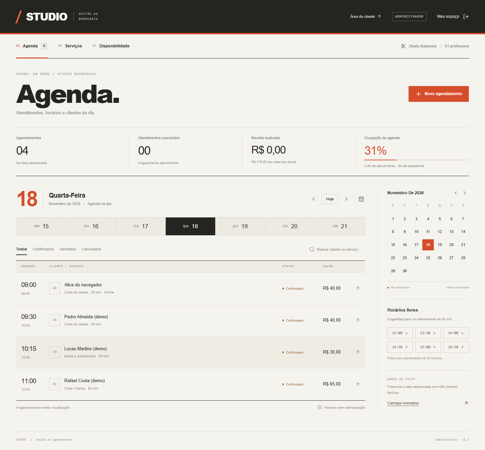
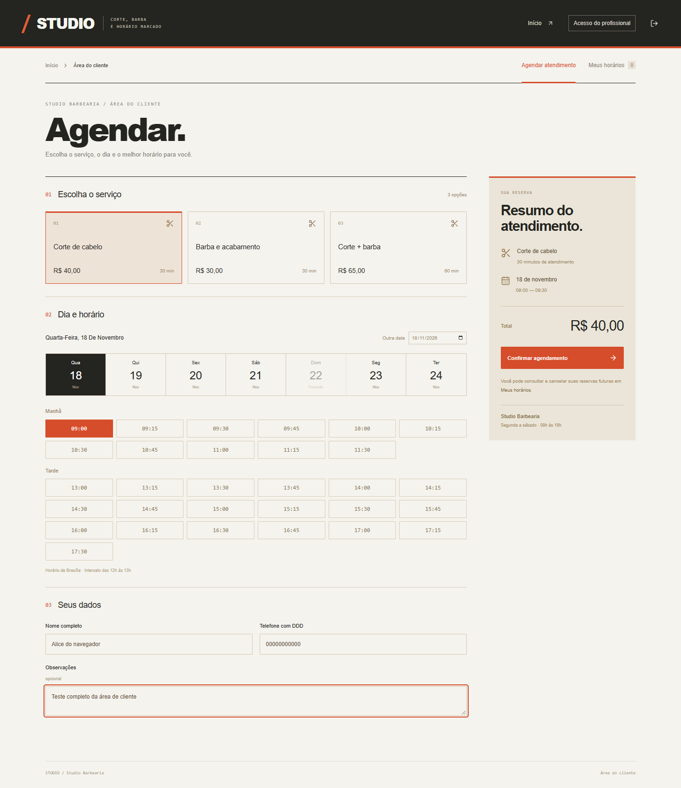

# Agenda Studio

Agendamento para uma barbearia com um profissional, com duas áreas: **cliente** e **dono do negócio**. Clientes reservam seus horários e acompanham apenas as próprias reservas. O dono gerencia a agenda compartilhada, serviços e bloqueios. O banco impede reservas simultâneas no mesmo intervalo.

## Demonstração no GitHub Pages

[Abrir demonstração interativa](https://mateusmarques2026.github.io/agenda-studio/)

A demonstração usa as mesmas interfaces do projeto com um adaptador exclusivo em demo/. Os dados são fictícios, ficam no armazenamento local do navegador e podem ser reiniciados pelo botão no topo. A troca de visão simula os papéis para apresentação; não é autenticação nem controle de acesso real. Não use dados pessoais nesta demonstração. A versão completa com servidor, identidade e SQL permanece no restante do projeto.

Para executar: npm ci, npm run demo:build e npm run demo:dev. O comando demo:build gera dist-demo/; o workflow pages.yml publica essa pasta. Em Settings → Pages, a origem é GitHub Actions.

## As duas áreas

| Rota | Acesso | Funcionalidades |
| --- | --- | --- |
| / | Entrada | Apresentação da barbearia e acesso às duas áreas |
| /entrar | Entrada | Login, conta conectada e indicação explícita de teste local |
| /cliente | Conta conectada | Serviços, disponibilidade, nova reserva, próximos atendimentos, histórico e cancelamento próprio |
| /admin | Dono configurado | Agenda completa, busca, filtros, cadastro/edição/pausa de serviços, bloqueios, conclusão e cancelamento de atendimentos |

A identidade visual usa grafite, branco e laranja, navegação horizontal, horários legíveis e textos sobre ações do negócio.

## Modelo de acesso

A autenticação usa a identidade fornecida pelo Sites. O ID estável do usuário vincula as reservas ao cliente. O papel de administrador é determinado **no servidor**, pela conta cujo e-mail corresponde à variável de runtime STUDIO_ADMIN_EMAIL. Não há cadastro público de administradores, seletor de papel ou confiança em um ID enviado pelo navegador.

Na primeira entrada autorizada do dono, o negócio é inicializado com seu ID. Todas as reservas usam a agenda desse negócio. Reservas anteriores continuam com o mesmo dono e passam a ser registros administrativos; não são atribuídas automaticamente a clientes por nome ou telefone.

A API do cliente entrega apenas serviços ativos, minutos ocupados e suas próprias reservas. Não entrega nomes/telefones de outras pessoas, motivos dos bloqueios ou relatórios. Uma tentativa de entrar em /admin com conta de cliente é redirecionada; as APIs administrativas retornam 403.

O cancelamento pelo cliente exige que a reserva pertença à sua identidade, ainda esteja confirmada e seja futura. Só o profissional pode concluir um atendimento.

> A demonstração hospedada continua privada. Para atender clientes externos, é necessário alterar explicitamente o compartilhamento do Site. Permissões dentro da aplicação e acesso ao Site são camadas diferentes.

## Funcionalidades

- Reserva em três etapas: serviço, dia/horário e contato.
- Confirmação, próximos atendimentos e histórico na conta do cliente.
- Cancelamento próprio com confirmação e liberação do intervalo.
- Reservas do cliente aparecem como Online na agenda do dono.
- Agenda administrativa com calendário, busca, filtros e indicadores.
- Atualização manual e automática da agenda a cada 30 segundos enquanto a página está visível.
- Conta conectada com nome, perfil e saída da sessão.
- Cadastro e edição de preços/durações, pausa e reativação de serviços.
- Bloqueios para compromissos pessoais, sem expor seus motivos aos clientes.
- Histórico de preço/duração preservado em cada reserva.
- Concorrência protegida por chave única e transação SQL.
- Interface para desktop e celular.

## Executar localmente

Requisitos: Node.js 24, npm e Git. Não precisa criar conta na Cloudflare para usar o banco local.

~~~sh
npm ci
npm run build
npm run db:migrate:local
npm run dev
~~~

Abra o endereço exibido no terminal, normalmente http://localhost:5173. O modo local simula a conta seedy@sites.test como dona do negócio. Abra /entrar e use “Entrar com conta de teste”. As áreas protegidas redirecionam para essa tela quando não há sessão. Isso não é autenticação própria por senha.

O banco local persiste em .wrangler/state. As migrações do Wrangler são rastreadas e não são reaplicadas nas próximas execuções. O banco publicado é separado.

## Configurar o dono em produção

Defina STUDIO_ADMIN_EMAIL com o e-mail da conta responsável nas variáveis de runtime do Sites e publique uma versão. A variável é lida apenas no servidor, sem fallback de administrador em produção. Sem configuração, nenhuma conta recebe acesso administrativo.

A identidade do dono fica vinculada ao negócio após a primeira entrada autorizada. Trocar o responsável depois exige um processo explícito de transferência; mudar somente o e-mail configurado não transfere dados ou privilégios para outro ID.

Não salve e-mails de produção, tokens ou valores secretos no código, no manifesto de hosting ou no bundle do navegador.

## Testar

~~~sh
npm test
npm run typecheck
npm run build
~~~

Para os testes HTTP entre contas distintas, inicie a prévia de teste em um terminal:

~~~sh
npm run dev:roles
~~~

Em outro terminal:

~~~sh
npm run test:integration
~~~

O comando dev:roles ativa um middleware **exclusivamente local** com dois perfis fictícios (Alice e Bruno) selecionados pelo cabeçalho x-studio-test-user. Ele exige login local prévio e origem de loopback, não altera o login padrão e não é incluído no Worker de produção. Não habilite ferramentas de teste em um ambiente público.

A integração verifica o dono, dois clientes, autorização administrativa, isolamento de reservas, tentativa de alterar o papel, corrida pelo mesmo intervalo, cancelamento, bloqueios e preservação do histórico. Escreve registros fictícios no banco local em datas futuras. Use AGENDA_TEST_URL para selecionar outra porta local.

A CI em .github/workflows/ci.yml executa testes de domínio/permissões, TypeScript, build, migrações e integração HTTP.

## Como a concorrência é resolvida

Um atendimento de 09h às 10h ocupa quatro intervalos de 15 minutos. A chave primária de occupied_slots é composta por dono, data e minuto. A inserção da reserva e dos intervalos ocorre em um batch atômico do D1.

Se dois clientes ou o dono e um cliente disputarem o mesmo intervalo, somente uma transação confirma. A perdedora recebe HTTP 409 e não deixa uma reserva órfã. Bloqueios usam a mesma tabela. Cancelamentos removem os intervalos e mudam o status de forma atômica, com a condição de propriedade/status aplicada dentro da transação.

## Regras de negócio

- Um negócio e um profissional nesta versão.
- Segunda a sábado, 09h–18h, com almoço 12h–13h.
- Fuso America/Fortaleza (UTC−3), independente do computador do visitante.
- Serviços em múltiplos de 15 minutos; reservas até 90 dias à frente.
- Não reserva horários passados ou cruzando o almoço.
- Valores em centavos inteiros.
- Nome, duração e preço do serviço são copiados para a reserva; mudanças futuras não alteram o histórico.
- Serviços pausados não aparecem para novas reservas.
- Atendimento concluído mantém o intervalo ocupado e não pode ser cancelado pelo cliente.
- Receita realizada inclui apenas atendimentos concluídos.
- A lista do cliente retorna as 200 reservas mais recentes; paginação é um próximo incremento.

## Estrutura

~~~text
app/page.tsx                    Entrada com as duas áreas
app/admin/page.tsx              Proteção da página do dono
app/agenda.tsx                  Painel administrativo
app/cliente/page.tsx            Entrada autenticada do cliente
app/cliente/customer.tsx        Agendamento e minhas reservas
app/api/[...path]/route.ts      APIs autenticadas e autorização
lib/studio-access.ts            Identidade do dono e negócio compartilhado
lib/permissions.ts              Políticas puras de acesso/cancelamento
lib/repository.ts               Operações e transações D1
lib/scheduling.ts               Regras de datas/horários
db/schema.ts                   Schema e índices
drizzle/                       Migrações incrementais
tests/                         Regras, permissões e integração
~~~

## API

| Método | Rota | Acesso |
| --- | --- | --- |
| GET | /api/session | Identidade conectada e seu papel |
| GET | /api/customer/availability?date=AAAA-MM-DD | Cliente: catálogo ativo e minutos ocupados |
| GET | /api/customer/bookings | Apenas reservas da própria conta |
| POST | /api/customer/bookings | Cria reserva ligada à identidade autenticada |
| PATCH | /api/customer/bookings/:id | Cancela reserva própria futura |
| GET | /api/admin/day?date=AAAA-MM-DD | Dono: agenda completa do dia |
| POST/PATCH | /api/admin/services e /:id | Dono: catálogo |
| PATCH | /api/admin/service-status/:id | Dono: ativação do serviço |
| POST/PATCH | /api/admin/bookings e /:id | Dono: atendimento administrativo e status |
| POST/DELETE | /api/admin/blocks e /:id | Dono: bloqueios |

Os endpoints administrativos sem o prefixo /admin permanecem como aliases de compatibilidade e exigem a mesma autorização. Mutações validam Origin quando presente; POST/PATCH exigem JSON. Dados inválidos retornam 400, login ausente 401, acesso administrativo negado 403, reserva de outra conta 404 e conflito 409.

## Tecnologias

TypeScript, React, App Router com Vinext/Vite, Cloudflare Workers, D1/SQLite, Drizzle, Zod, Lucide e CSS próprio. O projeto parte do starter do Sites e preserva sua integração de autenticação e publicação.

## Próximos incrementos

Reagendamento atômico, expediente semanal editável, múltiplos profissionais, notificações e paginação do histórico. Pagamentos e autenticação própria por senha não fazem parte desta versão.

## Enviar ao GitHub

Crie um repositório vazio chamado agenda-studio. Se veio do ZIP, execute git init, git add . e git commit -m "Cria Agenda Studio". Adicione o repositório com git remote add origin URL_DO_REPOSITORIO e envie com git push -u origin HEAD:main. Preserve um eventual remote do Sites renomeando-o antes.

O ZIP inclui código, documentação, capturas e workflow de CI. Não inclui node_modules, banco local, ambiente ou credenciais. Publicar o código no GitHub não publica automaticamente a aplicação.

O código teve assistência de IA. Antes de apresentar o projeto, pratique explicar a transação de reserva, a separação de permissões e o vínculo da identidade às consultas.
